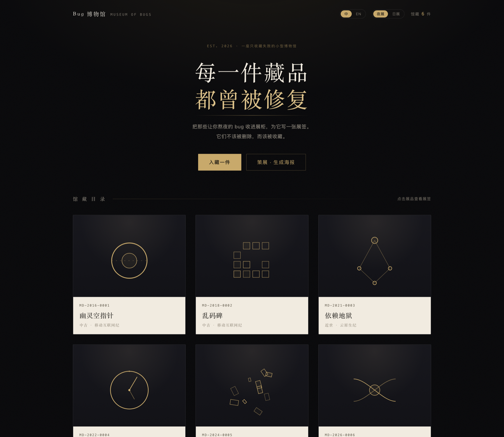
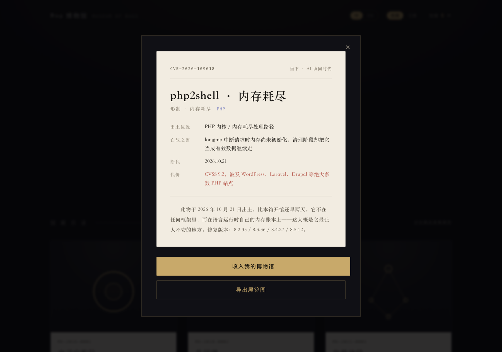
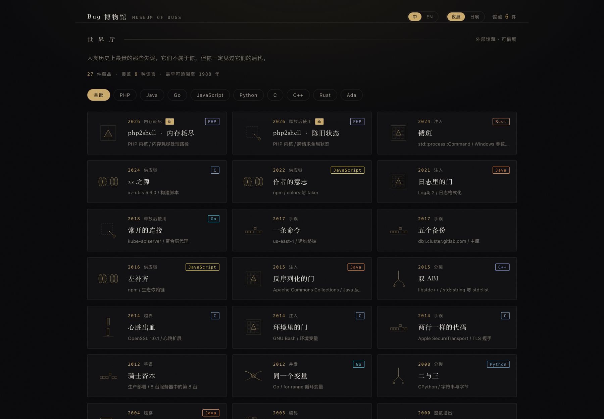
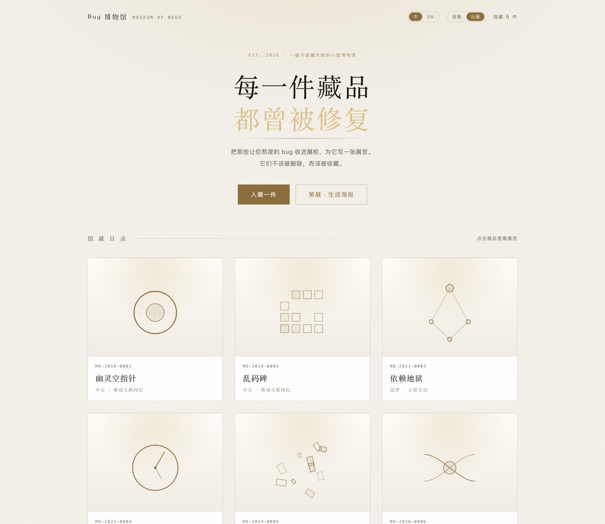
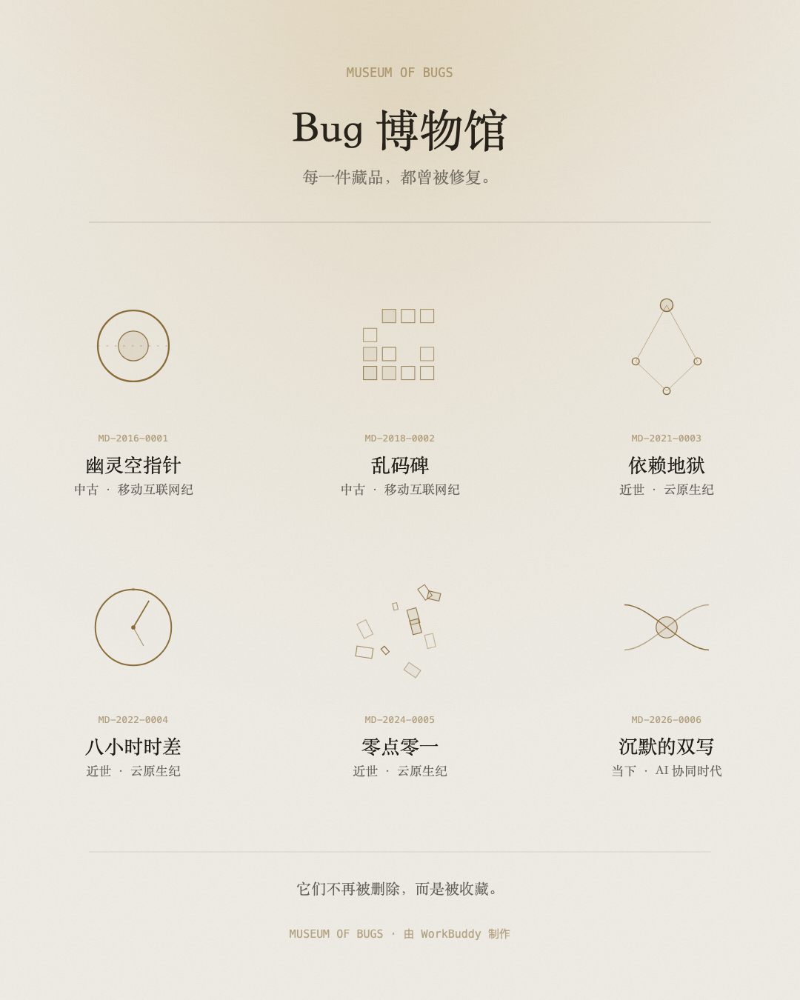

<div align="center">


# Bug 博物馆

**把修过的 bug 收进展柜，为它写一张展签。**

<sub>纯静态 · 零依赖 · 零构建 · 数据只存在本地</sub>

<sub>[English](README.en.md) · **中文**</sub>

</div>



---

## 这是什么

Bug 博物馆是一个只收藏失败的线上展厅。修完一个坑，趁记忆还热，用一分钟把它登记入藏——起名、选形制、填一句死因——系统会按年份自动断代，写出一段馆藏说明，再用程序化生成的几何图形把它铸成一件「文物」，摆进你的展柜。

它想说的其实很简单：**那些让你熬夜的东西，不该被随手删掉，而该被留下。**

## 长什么样

| 单件展签 | 世界厅 |
|:---:|:---:|
|  |  |
| **日展（纸 + 墨）** | **策展海报** |
|  |  |

## 主要功能

- **入藏登记** —— 19 种形制（空指针 / 时区 / 并发 / 玄学 / 内存耗尽 / 供应链……），每种配一句文言描述和默认死因，选一个就能自动填好。
- **自动展签** —— 按年份断代（太古·前 Web 纪 → 当下·AI 协同时代），拼出一段馆藏说明。
- **程序化文物** —— 每件藏品的「雕塑」由形制 + id 哈希生成，同类形制同源，每件又都不一样。全站没有一张图片素材。
- **导出** —— 1000×1400 展签图、1080×1350 策展海报，全部由原生 Canvas 绘制。
- **世界厅** —— 27 件真实事故，覆盖 9 种语言，可筛选、可「借展」进自己的馆，和你的 bug 并排挂。
- **中英双语 · 夜展 / 日展** —— 两个维度自由组合，导出图跟随当前主题。

## 世界厅

收录的不是杜撰，是公开历史记录：

| 语言 | 藏品 |
|---|---|
| PHP | php2shell 内存耗尽、php2shell 陈旧状态（CVE-2026-109618 / 109619） |
| Java | 日志里的门（Log4Shell）、反序列化的门（Commons Collections） |
| Go | 常开的连接（Kubernetes CVE-2018-1002105）、同一个变量（循环变量） |
| JavaScript | 左补齐（left-pad）、作者的意志（colors.js）、空即对象 |
| Python | 二与三（Py2 → Py3）、默认的空列表 |
| C | 心脏出血、环境里的门（Shellshock）、xz 之隙、两行一样的代码（goto fail）、第一个蠕虫 |
| C++ / Rust / Ada | 双 ABI、锈斑、阿丽亚娜 5 号 |
| 跨语言 | 火星气候探测器、骑士资本、一条命令（S3）、五个备份（GitLab）、千年虫、假 UTF-8 |

每件都只述因果，不含任何利用细节。

## 运行

没有构建步骤，没有依赖。

```bash
# 直接打开
open index.html

# 或者起个静态服务（推荐，避免个别浏览器的本地文件限制）
python3 -m http.server 8080
```

## 目录结构

```
index.html              入口
assets/
  css/                  base · layout · exhibit · modal
  js/                   data · data.en · util · i18n · theme · art
                        store · render · exhibit · form · curate · export · app
  icon.svg              图标
submission/             投稿文案与界面截图
```

**为什么是经典 `<script>` 而不是 ES Module**：ESM 在 `file://` 下会被 CORS 拦掉，双击打开就是白屏。这里用 `window.MOD` 命名空间协作，14 个脚本按依赖顺序加载，双击也能跑。

## 技术要点

- 原生 HTML / CSS / JavaScript，**没有任何第三方库、CDN 或构建工具**。
- 数据存在 `localStorage`；在小工具容器里会写穿到平台 Storage API。
- 文物是 SVG 字符串拼出来的，用 id 哈希 + LCG 做确定性伪随机。
- 导出用原生 Canvas；SVG 经 data URI 转成 Image 再 `drawImage`。深色大面积渐变上叠了 3% 噪点，否则会出色带。
- 兼容基线是 **Chrome 61**（Android 8.1 出厂 WebView），没有 `clamp()`、Flex `gap`、`color-mix()`、`inset`。

## 相关

`BugMuseum-minitool.zip` 是适配小红书小工具容器的打包产物（本地构建，未入库）：容器禁用了 `a[download]`，所以导出改走 `saveImageToPhotosAlbum`，其余环境回退为页内预览。

## 许可

基于 [MIT License](LICENSE) 开源。代码随取随用，不必署名——但如果你也做了一座博物馆，欢迎告诉我。

---

<div align="center">
<sub>为 WorkBuddy 1024 造物挑战而作 · 2026</sub>
</div>
